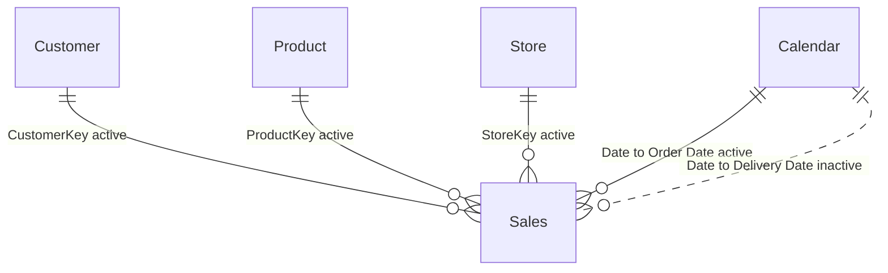

# sales Semantic Model

## Overview

The sales model supports retail revenue, cost, margin, customer participation, product, and store analysis. It is the local semantic model behind the [sales report](sales.report.md), whose headings identify Northwind Retail Group.

| Property | Value |
|---|---|
| Source | [lab2/resources/sales.SemanticModel](../lab2/resources/sales.SemanticModel/) |
| Model metadata name | Model |
| Storage mode | Import; one M partition per data table |
| Tables / columns | 7 / 68 |
| Measures / relationships | 16 / 5 |
| Hierarchies / calculation groups | 1 / 1 |
| Security roles | 0 |
| Model culture / source query culture | en-US / en-GB |
| Implicit measures | Discouraged |

The five business tables and thirteen original measures remain visible. Currency Conversion adds a visible reporting-currency selector; Currency Exchange and three internal conversion measures are hidden. Most numeric fact inputs and relationship keys are hidden to favor explicit measures. The explanations below describe expressions and field names in the context of the supplied [business context](../lab2/resources/company-context.md).

## Model Structure



Sales is the fact table, with Calendar, Customer, Product, and Store as dimensions. All relationships are many-to-one from Sales to the dimension, with **one-direction filtering from the dimension to Sales**.

| Sales column | Dimension column | Active | Implication |
|---|---|---|---|
| CustomerKey | Customer.CustomerKey | Yes | Customer selections filter sales |
| ProductKey | Product.ProductKey | Yes | Product selections filter sales |
| StoreKey | Store.StoreKey | Yes | Store selections filter sales |
| Order Date | Calendar.Date | Yes | Calendar selections analyze orders by order date |
| Delivery Date | Calendar.Date | No | Delivery-date analysis requires explicit relationship activation; none of the current measures does so |

Because Sales does not filter dimensions back through these relationships, dimension row counts are not automatically counts of entities with sales in the selected period.

Currency Exchange and Currency Conversion are intentionally disconnected utility tables. Conversion looks up a rate by date, source currency, and target currency without introducing a many-to-many relationship or filtering sales to only month-end transactions.

## Currency Conversion

The **Currency Conversion[Currency]** calculation group has three items, ordered **EUR**, **USD**, and **GBP**, with precedence 10. Add this field to a single-select slicer to change reporting currency, or to matrix columns to compare currencies side by side. Turn off the matrix total across currencies: adding different reporting currencies is not meaningful.

Each item converts these existing financial measures and applies a two-decimal format labeled with the selected ISO currency code:

- Sales Amount, Cost, and Margin.
- Sales Amount (LY), using the prior-year sales dates and their rates.
- Sales Amount Avg per Day, Sales Amount (6M average), and Sales Amount (12M average), averaging converted daily amounts rather than multiplying an aggregate average by one exchange rate.

Counts, Sales Qty, and other measures retain their original values and formats. With no currency selection, existing measure expressions and formats are unchanged, including their original mixed-currency behavior. Multiple or empty currency selections raise an explicit error for the financial measures instead of returning a combined-currency total.

### Rate source and policy

Currency Exchange imports [RAW-CurrencyExchange.csv](https://raw.githubusercontent.com/RuiRomano/workshop-fabcon-26-bcn/main/resources/sample-data/RAW-CurrencyExchange.csv) as four explicitly typed columns:

| Model column | CSV column | Type | Meaning |
|---|---|---|---|
| Date | Date | DateTime | Rate date |
| From Currency | FromCurrency | String | Sales transaction currency |
| To Currency | ToCurrency | String | EUR, USD, or GBP reporting currency |
| Exchange Rate | Exchange | Decimal | Multiplier from source to target currency |

For each sales line, conversion multiplies the local amount by the rate matching **Sales[Currency Code]**, the selected reporting currency, and:

- **Before 2020:** the last date of the order's month, using that month's closing rate.
- **From January 2020:** the exact order date, using the daily rate.

Conversion happens before aggregation, so mixed source currencies and multi-period totals use the appropriate rates for every line. Sales[Exchange Rate] is not used, avoiding a second conversion through that unrelated imported field. Missing, nonpositive, or conflicting rates cause an error rather than silently dropping sales or substituting a rate of one.

Three hidden Sales measures implement the shared logic: Currency Conversion Rate, Sales Amount (Converted), and Cost (Converted). The calculation items derive converted margin as converted sales less converted cost and preserve the original prior-year and rolling-window guards. Future financial measures need explicit inclusion in the calculation items and their format expressions.

After refreshing in Power BI Desktop, a useful comparison query is:

```dax
EVALUATE
    SUMMARIZECOLUMNS (
        'Currency Conversion'[Currency],
        "Net Sales", [Sales Amount],
        "Cost", [Cost],
        "Margin", [Margin],
        "Prior Year", [Sales Amount (LY)],
        "Daily Average", [Sales Amount Avg per Day],
        "Units", [Sales Qty]
    )
ORDER BY 'Currency Conversion'[Currency]
```

The expected shape is three rows, with identical units across currencies and margin equal to net sales minus cost. Runtime refresh and DAX execution require Power BI Desktop or a deployed model; offline metadata validation does not execute these calculations.

## Tables and Columns

Types are the tabular metadata types. `Decimal` is the fixed-decimal currency type here; `DateTime` columns can have date-only or time-only source semantics. `Unknown` on the calculated Age column is the type reported by the offline metadata connection, not a claim that its expression returns text.

### Calendar

One row per date from **2017-01-01 through 2021-12-31**, generated in Power Query rather than downloaded.

| Column | Data type | Visibility | Description |
|---|---|---|---|
| Day | Int64 | Visible | Day of month |
| Month | Int64 | Hidden | Month number; sorts Month Name |
| Quarter | String | Visible | Calendar quarter label, Q1 through Q4 |
| Year | Int64 | Visible | Calendar year |
| Date | DateTime | Hidden | Daily date used by relationships and time calculations |
| Month Name | String | Hidden | Abbreviated month name, sorted by Month |
| Year-Month | DateTime | Visible | Month-level date attribute displayed as `mmm yyyy`; query converts year/month text to a date |
| Week Number | Int64 | Visible | Power Query week-of-year value |
| Day of Week | Int64 | Visible | Power Query weekday number plus one |
| Day Name | String | Visible | Weekday name, sorted by Day of Week |
| Is Weekend | Boolean | Hidden | Computed from `Date.DayOfWeek([Date]) >= 5` |
| Fiscal Year | Int64 | Hidden | Year increments for months July through December |
| Fiscal Quarter | String | Visible | Label from the implemented formula described below |

The visible **Year-Month-Day** hierarchy has levels Year, Month, and Day, bound to those numeric columns. It is distinct from the standalone Year-Month column.

### Calendar and fiscal periods

The current query sets Fiscal Year to `Year + 1` for months 7-12, otherwise Year. It sets Fiscal Quarter to `"FQ" & Number.IntegerDivide(Month + 5, 3)`, producing FQ2 for January-March, FQ3 for April-June, FQ4 for July-September, and FQ5 for October-December.

These are the **implemented formulas**, not Northwind's February-January convention from the company context. The report currently uses Calendar Year and Year-Month, not the fiscal fields. Do not label its year comparisons as fiscal reporting without reconciling the model first.

Week/day calculations do not specify an explicit first day of week. Their interpretation, and especially the weekend flag, should be verified in the execution environment before business use. The fixed calendar end also limits time analysis if source data is extended beyond 2021.

### Sales

One imported order line, identified in the source by Order Number and Line Number. No uniqueness or row-count check was run. Quantity and net price are modified by the refresh query, so these are workshop sample results rather than an untouched transaction extract.

| Column | Data type | Visibility | Description |
|---|---|---|---|
| Order Number | Int64 | Visible | Source order identifier; can repeat across order lines |
| Line Number | Int64 | Visible | Line identifier within an order |
| Order Date | DateTime | Visible | Active date for sales reporting |
| Delivery Date | DateTime | Visible | Alternate date with an inactive Calendar relationship |
| CustomerKey | Int64 | Hidden | Customer foreign key |
| StoreKey | Int64 | Hidden | Store foreign key |
| ProductKey | Int64 | Hidden | Product foreign key |
| Unit Cost | Decimal | Hidden | Per-unit cost used in Cost and Margin |
| Currency Code | String | Visible | Source transaction currency label |
| Exchange Rate | Decimal | Visible | Imported rate; not used in current measures |
| Environment | String | Visible | Copy of the Environment parameter at refresh |
| Time | DateTime | Visible | Randomly generated time-of-day value |
| Quantity | Int64 | Hidden | Randomized quantity used in Sales Qty and financial measures |
| Net Price | Decimal | Hidden | Randomized per-unit net price used in revenue and margin |

### Product

Product dimension, with one intended row per ProductKey and descriptive category, manufacturer, and pricing attributes.

| Column | Data type | Visibility | Description |
|---|---|---|---|
| Product | String | Visible | Product name, renamed from Product Name |
| ProductKey | Int64 | Hidden | Relationship key |
| Product Code | String | Visible | Business-facing product code |
| Manufacturer | String | Visible | Manufacturer label |
| Brand | String | Visible | Brand label |
| Color | String | Visible | Product color |
| Weight Unit Measure | String | Visible | Unit for Weight |
| Weight | Decimal | Visible | Product weight; interpreted with its unit |
| Unit Cost | Decimal | Visible | Product reference cost; not the input used by the Cost measure |
| Unit Price | Decimal | Visible | Product reference price; not the input used by Sales Amount |
| Subcategory Code | String | Visible | Product subcategory code |
| Subcategory | String | Visible | Product subcategory label |
| Category Code | String | Visible | Product category code |
| Category | String | Visible | Product category label |

### Customer

Customer dimension, with one intended row per CustomerKey, demographic attributes, and postal geography.

| Column | Data type | Visibility | Description |
|---|---|---|---|
| CustomerKey | Int64 | Hidden | Relationship key |
| Gender | String | Visible | Source gender classification |
| Customer | String | Visible | Customer name, renamed from Name |
| Address | String | Visible | Street address |
| City | String | Visible | City |
| State Code | String | Visible | State/region abbreviation |
| State | String | Visible | State/region name |
| Zip Code | String | Visible | Postal code; stored as text |
| Country Code | String | Visible | Country code |
| Country | String | Visible | Country name |
| Continent | String | Visible | Continent |
| Birthday | DateTime | Visible | Date of birth |
| Age | Unknown (calculated) | Visible | Year-boundary difference between Birthday and TODAY at recalculation |

Age is a DAX calculated column, not the source CSV's Age field: the import query removes the latter.

```dax
DATEDIFF(
    [Birthday],
    TODAY(),
    YEAR
)
```

This counts year boundaries rather than completed birthdays and changes when the model recalculates, not on every report interaction.

### Store

Store dimension, with one intended row per StoreKey, location, operating dates, and floor area.

| Column | Data type | Visibility | Description |
|---|---|---|---|
| StoreKey | Int64 | Hidden | Relationship key |
| Store Code | String | Visible | Business-facing store code |
| Country | String | Visible | Store country |
| State | String | Visible | Store state/region |
| Store | String | Visible | Store name, renamed from Name |
| Square Meters | Int64 | Visible | Store floor area; no sales-per-square-meter measure exists |
| Open Date | DateTime | Visible | Opening date |
| Close Date | DateTime | Visible | Closing date when supplied; default summarization is Count |
| Status | String | Visible | Source operational status |

## Measures

Unless stated otherwise, measures respect the current product, customer, store, and Calendar filter context. Calendar filters reach Sales through **Order Date**.

### Sales Amount

Host table: Sales. Sum of line quantity multiplied by line net price. This is the model's net-sales basis for the business's revenue terminology; there is no separate deduction for returns or discounts beyond what is already encoded in the source net price/quantity.

```dax
SUMX('Sales', 'Sales'[Quantity] * 'Sales'[Net Price])
```

Format: `$ #,##0`. Neither Exchange Rate nor Currency Code is used; the dollar symbol is formatting, not proof that mixed currencies were converted.

### Sales Qty

Host table: Sales. Total individual units across filtered sales lines, not the number of orders, baskets, or customers.

```dax
sum('Sales'[Quantity])
```

Format: `#,##0`.

### Cost

Host table: Sales. Sum of line quantity multiplied by the transaction's unit cost, not Product.Unit Cost.

```dax
SUMX ( Sales, Sales[Quantity] * Sales[Unit Cost] )
```

Format: `$ #,##0`.

### Margin

Host table: Sales. Absolute sales margin amount, calculated at line level as quantity times net price less unit cost. It is not a margin percentage.

```dax
SUMX (
    Sales,
    Sales[Quantity]
        * ( Sales[Net Price] - Sales[Unit Cost] )
)
```

Format: `$ #,##0`. Under the same filters, its algebraic basis is Sales Amount minus Cost; numeric reconciliation was not executed.

### # Sales

Host table: Sales. Count of sales rows/order lines, not a distinct count of Order Number. A multi-line order contributes multiple rows.

```dax
COUNTROWS('Sales')
```

The stored format is `#,##02`; this is preserved here as-is rather than normalized to the other count measures' `#,##0`.

### # Customers (w/ Sales)

Host table: Sales. Distinct customer keys present in the filtered fact rows. Unlike the Customer dimension row count, it responds to date, store, and product selections that restrict Sales. DAX DISTINCTCOUNT includes a blank key if present.

```dax
DISTINCTCOUNT('Sales'[CustomerKey])
```

Format: `#,##0`.

### Sales Amount (LY)

Host table: Sales. Prior-year Sales Amount over the dates returned by SAMEPERIODLASTYEAR, retaining other business filters. It returns blank unless current-context Sales Amount is greater than zero, so it can hide a prior-year value when current sales are zero, negative, or blank.

```dax
IF ([Sales Amount] > 0, CALCULATE([Sales Amount], SAMEPERIODLASTYEAR('Calendar'[Date])))
```

The stored format uses a **euro** symbol, unlike the current-year measure's dollar symbol. This expression performs a date shift only; it does not perform currency conversion or define a February-start fiscal comparison.

### Sales Amount Avg per Day

Host table: Sales. Evaluates Sales Amount for each distinct Calendar date in the current context and averages the resulting nonblank amounts. Dates with no sales normally return blank and are omitted by AVERAGEX; this is not necessarily total sales divided by every elapsed calendar day. Zero-valued daily results are included.

```dax
AVERAGEX(VALUES('Calendar'[Date]), [Sales Amount])
```

Format: `$ #,##0`.

### Sales Amount (12M average)

Host table: Sales. Anchors a trailing 12-month date window at the latest selected Calendar date, then averages **daily** Sales Amount results inside the calculated date context. It is not an average of twelve monthly totals. Nonblank-day behavior follows the daily-average measure described above.

```dax
VAR v_selDate =
    MAX ( 'Calendar'[Date] )
VAR v_period =
    DATESINPERIOD ( 'Calendar'[Date], v_selDate, -12, MONTH )
VAR v_result =
    CALCULATE ( AVERAGEX ( VALUES ( 'Calendar'[Date] ), [Sales Amount] ), v_period )
VAR v_firstDate =
    MINX ( v_period, 'Calendar'[Date] )
VAR v_lastDateSales =
    MAX ( Sales[Order Date] )
RETURN
    IF ( v_firstDate <= v_lastDateSales, v_result )
```

The guard compares the window's first date with the latest Sales.Order Date in the original context. It does not require a complete 12-month history. Calendar coverage and remaining filters can constrain the available dates; no runtime result was tested. Format: `$ #,##0`.

### Sales Amount (6M average)

Host table: Sales. Same daily-average pattern and guard as the 12-month version, using a trailing six-month window.

```dax
VAR v_selDate =
    MAX ( 'Calendar'[Date] )
VAR v_period =
    DATESINPERIOD ( 'Calendar'[Date], v_selDate, -6, MONTH )
VAR v_result =
    CALCULATE ( AVERAGEX ( VALUES ( 'Calendar'[Date] ), [Sales Amount] ), v_period )
VAR v_firstDate =
    MINX ( v_period, 'Calendar'[Date] )
VAR v_lastDateSales =
    MAX ( Sales[Order Date] )
RETURN
    IF ( v_firstDate <= v_lastDateSales, v_result )
```

Format: `$ #,##0`. Neither rolling measure is bound to a visual in the current report.

### # Products

Host table: Product. Counts filtered Product dimension rows. A Calendar or Store selection does not automatically restrict this count to products with sales because relationships filter toward Sales only.

```dax
COUNTROWS('Product')
```

Format: `#,##0`.

### # Customers

Host table: Customer. Counts filtered Customer dimension rows, not purchasing customers. Use # Customers (w/ Sales) for customer participation in the current sales context.

```dax
COUNTROWS('Customer')
```

Format: `#,##0`.

### # Stores

Host table: Store. Counts filtered Store dimension rows; it does not exclude closed stores or require sales unless an appropriate dimension filter is supplied.

```dax
COUNTROWS('Store')
```

Format: `#,##0`.

### Report-local calculation

The Sales page area chart also defines `MOVINGAVERAGE([Sales Amount], 12)` as a visual calculation. It is not a semantic measure and is not either rolling daily-average measure above. See the [report guide](sales.report.md#main-metrics).

## Security

No RLS or OLS roles were found in the local source model. Country-based restrictions mentioned in the company context are therefore not implemented here. Hidden columns are field-list presentation choices, not access controls.

Customer names, addresses, and birthdays are visible model fields. Review access requirements before deploying or sharing this sample. Workspace/item permissions and any separately configured service security were not inspected.

## Data Sources and Refresh

### Connection parameters

| Shared M expression | Current value | Use |
|---|---|---|
| HttpSource | `https://raw.githubusercontent.com/RuiRomano/workshop-fabcon-26-bcn/main/resources/sample-data/` | Required text parameter used by Web.Contents |
| Environment | `DEV` | Required text parameter with DEV, QUAL, and PRD choices; appended to Sales |
| Randomizer | `0.6` | Required numeric parameter controlling sample quantity/net-price perturbation |

Changing Environment labels the imported rows; it does not select a different source URL or automatically deploy to another environment.

### Partitions

Each data table has one **Import / M** partition. Currency Conversion is a calculation-group table, not a CSV import.

| Table | Input | Main transformations |
|---|---|---|
| Calendar | Generated date list | Fixed date range, calendar and fiscal attributes, explicit types |
| Sales | RAW-Sales.csv | Promote headers, type columns, randomize Time/Quantity/Net Price, remove Unit Price, append Environment |
| Product | RAW-Product.csv | Promote headers, type columns, rename Product Name to Product |
| Customer | RAW-Customer.csv | Promote headers, type columns, rename Name to Customer, remove source Age |
| Store | RAW-Store.csv | Promote headers, type columns, rename Name to Store |
| Currency Exchange | RAW-CurrencyExchange.csv | Promote four headers and type date, source currency, target currency, and fixed-decimal rate using en-US parsing |

The CSV queries use comma delimiters, UTF-8, and `QuoteStyle.None`, with fixed expected column counts of 13, 14, 13, 9, and 4 for Sales, Product, Customer, Store, and Currency Exchange respectively. Local [sample CSVs](../resources/sample-data/) are supporting workshop resources; the configured imports fetch remote data. Currency Exchange uses the exact raw GitHub URL linked above rather than the HttpSource parameter.

### Refresh considerations

- Import refresh requires access to the configured web source and appropriate data source settings. No credentials or refresh schedule are defined by this documentation.
- Sales.Time is regenerated randomly on refresh. Quantity and Net Price are also regenerated within bounds derived from Randomizer; at its current positive setting, the upper bound is the original value, so the perturbation is not symmetric.
- Random values are not seeded; refreshing the same source can change report totals. Treat comparisons across refreshes as sample-data behavior, not business change.
- Customer.Age recalculates using TODAY. It is not the customer's age on the order date.
- The Calendar range is fixed and does not grow with the source data or today's date.
- Sales.Exchange Rate remains imported but unused; reporting-currency conversion uses the separate Currency Exchange lookup.
- Refresh Currency Exchange along with Sales before analyzing converted values. Extending Sales beyond the rate file's coverage requires corresponding new rates.
- Refresh and DAX values were not executed. The edited model was serialized and reloaded successfully, but offline metadata loading does not establish that a service refresh or DAX execution will succeed.

## Development Notes

The [team rules](../lab2/resources/team-rules.md) describe target standards, including uppercase measures and an optional About table. The model retains mixed-case measure names and has no About table. Currency conversion preserves existing business measures and descriptions and adds descriptions for its utility objects.

Use [AGENTS.md](../lab2/resources/AGENTS.md) when modifying the project. Currency-conversion objects were authored through the Power BI modeling MCP and exported to the local semantic-model definition.
